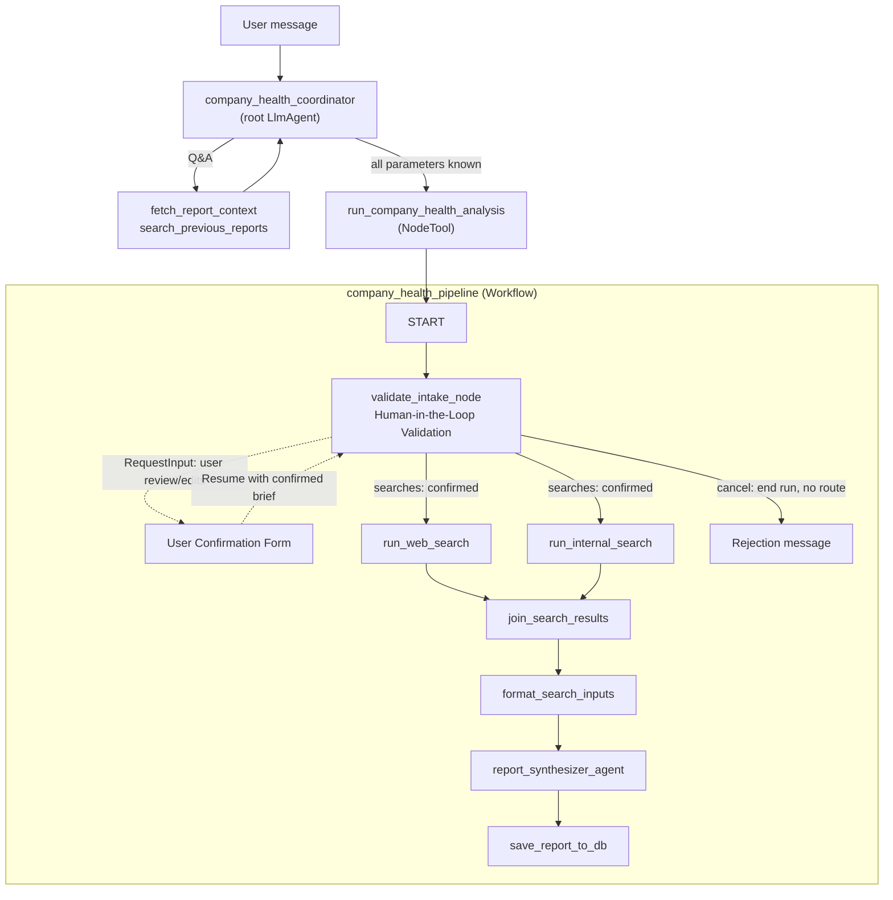

# company-health-analyst

## Use case
This application implements a dummy use case "enterprise financial health analyst agent" using the Google Agent Development Kit (ADK 2.0). A conversational coordinator agent elicits the analysis parameters, answers questions, and calls a deterministic analysis workflow **as a tool**. The workflow confirms the parameters with a human, executes parallel web and internal knowledge searches, and synthesizes a comprehensive Markdown company health report. After the report, the coordinator handles comparative strategic Q&A and parameter modifications.

### Example End-to-End Conversation (Integration Scenario)

This 10-turn multi-turn scenario demonstrates conversational intake, parameter elicitation, historical report inspection, human-in-the-loop confirmation, parallel search fan-out, report synthesis, post-report analytical Q&A, and parameter modification:

1. **Greeting & Capabilities Explanation**
   - **User:** *"Hello, what is this tool for?"*
   - **Agent:** The coordinator greets the user and explains that it is a company health assistant designed to analyze target companies across specified timeframes and geographic regions.
2. **Initial Analysis Request & Parameter Elicitation**
   - **User:** *"Analyze XYZ, it was founded in 2020 by John Doe"*
   - **Agent:** Captures the company name (`XYZ`) and founding context, identifies missing parameters (`region` and `time_span`), and asks follow-up questions to collect them.
3. **Conversational Question During Intake**
   - **User:** *"Remind me when was the company founded again?"*
   - **Agent:** Answers *"2020"* from the conversation history and asks for the missing region.
4. **Historical Report Lookup During Intake**
   - **User:** *"Give me the summary of past reports on the company"*
   - **Agent:** Calls [`search_previous_reports`](company_health_analyst/tools.py) to inspect archived reports, returns a summary, and resumes parameter collection.
5. **Providing Missing Parameter**
   - **User:** *"Europe"*
   - **Agent:** Records region `Europe` and asks for the target timeframe.
6. **Providing the Last Parameter & Launching the Pipeline**
   - **User:** *"ok, use 2026"*
   - **Agent:** With all three parameters known, the coordinator calls the [`run_company_health_analysis`](company_health_analyst/graph.py) tool (`XYZ`, `2026`, `Europe`). The workflow pauses at [`validate_intake_node`](company_health_analyst/nodes.py) and shows the confirmation form (`validate_captured_brief_1`).
7. **Confirming the Form & Generating the Report**
   - **User:** Presses **Submit** on the confirmation form.
   - **Agent:** The workflow resumes inside the same tool call, runs parallel web and internal searches, and streams the synthesized Markdown Company Health Report.
8. **Post-Report Comparison Q&A**
   - **User:** *"Compare this new report to past reports"*
   - **Agent:** The coordinator answers directly using [`fetch_report_context`](company_health_analyst/tools.py) and [`search_previous_reports`](company_health_analyst/tools.py), without re-running the pipeline.
9. **Modifying a Parameter**
   - **User:** *"Change the region to Asia and rerun it"*
   - **Agent:** The coordinator carries over `XYZ` and `2026`, calls the pipeline tool again with region `Asia`, and the workflow presents a fresh confirmation form (`validate_captured_brief_2`).
10. **Confirming Modified Parameters & Generating New Report**
    - **User:** Presses **Submit** on the second form.
    - **Agent:** The workflow runs fresh searches and streams an updated Company Health Report.


## Project Structure

```
company-health-analyst/
├── company_health_analyst/    # Core agent logic and FastAPI app
│   ├── agent.py               # Package agent entrypoint & App definition
│   ├── graph.py               # Root coordinator agent & pipeline Workflow exposed as a NodeTool
│   ├── nodes.py               # HITL validation gate & deterministic search/persistence nodes
│   ├── subagents.py           # Declares the report synthesizer agent used inside the pipeline
│   ├── schemas.py             # Pydantic data schemas (PipelineInput, IntakeValidationResponse, etc.)
│   ├── prompts.py             # System instructions & PromptTemplate definitions
│   ├── services.py            # Mock web search & internal financial search services
│   ├── tools.py               # Inspection tools (fetch_report_context, search_previous_reports)
│   ├── fast_api_app.py        # Production server entrypoint with streaming SSE endpoints
│   └── app_utils/             # Configuration & logging helpers
├── tests/                     # Test suite
│   ├── unit/                  # Fast offline unit tests (test_agent.py)
│   ├── integration/           # Live Vertex AI & scripted-model workflow replay tests
│   └── eval/                  # Evaluation methodology & datasets
├── app.py                     # Local ASGI application entrypoint
├── reasoning_engine.py        # Reasoning Engine wrapper entrypoint
├── Dockerfile                 # Container packaging definition
└── pyproject.toml             # Project dependencies, packaging, & tool configuration
```

## ADK 2.0 Specificities & Graph Design Choices

The application is built in [`company_health_analyst/graph.py`](company_health_analyst/graph.py) as two layers:

- **Conversational layer**: [`root_agent`](company_health_analyst/graph.py) (`company_health_coordinator`) is an `LlmAgent` that owns the whole conversation: greetings, parameter elicitation, analytical Q&A, and parameter modifications.
- **Deterministic layer**: [`company_health_pipeline`](company_health_analyst/graph.py) is an ADK 2.0 `Workflow` graph that performs human validation, parallel searches, report synthesis, and persistence. The coordinator invokes it as the `run_company_health_analysis` tool.

### Topology Diagram



### 1. Workflow as a Tool (`NodeTool`) Instead of Workflow as Root

The conversational coordinator is the root, and the deterministic graph is attached to it as a tool. This removes the need for an ingress routing node, an intent classifier, a task-mode intake agent, and a separate Q&A agent: the coordinator's own tool-choice judgement decides whether a turn is conversation, Q&A, or a (re)run of the analysis.

- **Why `NodeTool`**: A `Workflow` is a `BaseNode`, not a `BaseAgent`, so it cannot be placed in `sub_agents=[...]` or wrapped in `AgentTool`. `NodeTool` is the supported adapter: it runs the graph in the *caller's* invocation context, so HITL interrupts, resumability, and `ctx.state` are shared with the coordinator. A nested runner would create a detached session and silently break all three.
- **Explicit construction**: `LlmAgent` auto-wraps any `BaseNode` in `tools=[...]` with `NodeTool` at runtime, but the public `ToolUnion` type alias does not include `BaseNode`. The tool is therefore constructed explicitly as `NodeTool(node=company_health_pipeline)` so the code type-checks without suppressions.
- **Typed tool arguments via `input_schema`**: The pipeline declares `input_schema=PipelineInput`. `NodeTool` derives the function declaration from [`PipelineInput`](company_health_analyst/schemas.py), so the field descriptions (`company_name`, `time_span`, `region`) are what the coordinator's model reads when deciding how to call the tool, and the arguments arrive validated.
- **Tool name and description**: The workflow's `name` (`run_company_health_analysis`) and `description` become the tool name and description the coordinator routes on.
- **Long-running tool**: Because the pipeline always halts at the validation gate, the tool is long-running: the call pauses the invocation and resumes into a later turn once the user submits the form.

### 2. Coordinator Agent & Prompt Design

[`PromptTemplate.COORDINATOR`](company_health_analyst/prompts.py) merges intake and Q&A responsibilities into a single instruction:

- **Strict grounding**: The coordinator never invents parameter values and asks a targeted follow-up for each missing one.
- **Launching the analysis**: It must call `run_company_health_analysis` as soon as all three parameters are known (and not before). Stating in text that a report is underway does not run anything.
- **No duplicate confirmation**: The tool shows its own confirmation form, so the coordinator is instructed not to ask the user to confirm parameters in chat.
- **Parameter modifications**: It identifies the changed field, carries over the other values from the conversation, and calls the tool again with the complete, updated set.
- **Analytical Q&A**: It answers directly, without greetings or capability overviews, using [`fetch_report_context`](company_health_analyst/tools.py) for the active brief, searches, and report, and [`search_previous_reports`](company_health_analyst/tools.py) for historical comparisons.
- **Rejected runs**: If the tool returns status `rejected_by_user`, no report exists. The coordinator does not retry the same values and asks what to change.

Because the coordinator retains the full session history, multi-turn follow-ups ("remind me when it was founded", "compare to past reports") work without any explicit history plumbing.

### 3. Human-in-the-Loop (HITL) Validation Gate & Cycle-Scoped Interrupt IDs

[`validate_intake_node`](company_health_analyst/nodes.py) is the pipeline's entry node. Its `node_input` is the validated `PipelineInput` the coordinator passed to the tool. Before launching searches and synthesis, it requests human oversight:

- **Interrupt**: It formats a summary of the captured parameters and returns a `RequestInput` with `response_schema=IntakeValidationResponse`. The `RequestInput` propagates out through the tool boundary as an `adk_request_input` function call, and the ADK Web UI renders an interactive form.
- **Resume**: Users press **Submit** to confirm parameters as-is (blank fields retain captured values) or type into specific fields to override parameters. The confirmed brief is written to `ctx.state["company_brief"]` and the node emits an event routed to `"searches"`.
- **Cancel**: Ticking `cancel` ends the run. The node emits an unrouted event (every outgoing edge is gated on `"searches"`, so no search runs), does not adopt the declined parameters as the active brief, and returns `{"status": "rejected_by_user", ...}` as the tool result.
- **`cancel` instead of `approved`**: The ADK Web UI renders every boolean in `response_schema` as a checkbox that starts unticked and is posted on every submit, ignoring the field's declared default. An `approved: bool = True` field would arrive as `False` on every submission. A boolean on a HITL form can therefore only safely mean "do something extra", so Submit-untouched means proceed and ticking the box cancels.
- **Why cycle-scoped interrupt IDs are critical (`interrupt_id=f"validate_captured_brief_{cycle}"`)**:
  - In ADK 2.0, user responses to `RequestInput` are recorded keyed by `interrupt_id` and made available in `ctx.resume_inputs`.
  - With a static `interrupt_id`, a second pipeline run would find the previous run's answer already present in `ctx.resume_inputs`, skip the confirmation, and search with stale parameters.
  - The cycle is derived from `ctx.state["validation_cycles"]`, which counts gates the human has **answered** (approved or cancelled) and is only advanced on the resume pass. This keeps the ID stable across the node's interrupt/resume pair while advancing between runs.
  - Counting only approvals would let a cancelled run reuse its own ID on the retry, rediscover its own cancellation in `ctx.resume_inputs`, and cancel again without ever asking the human.

### 4. Who Speaks When the Tool Finishes

The two completion paths of the pipeline tool behave differently, and each needs its own handling:

| Path | Coordinator re-invoked after resume? | What the user sees |
|---|---|---|
| Human approves | Yes | `report_synthesizer_agent`'s streamed Markdown report. [`skip_report_summarization`](company_health_analyst/graph.py) (`after_tool_callback`) sets `skip_summarization` so the coordinator does not re-narrate the whole document. |
| Human cancels | No | The rejection message, which `validate_intake_node` attaches as `content` on its own event because the coordinator will not speak. |

Any new terminal state added to the pipeline has to decide which of these paths it is on and emit its own user-visible `content` if the coordinator will not be called.

### 5. `@node(rerun_on_resume=True)` on the Validation Gate

[`validate_intake_node`](company_health_analyst/nodes.py) is declared with the `@node(name="validate_intake_node", rerun_on_resume=True)` decorator:

- **Role of `rerun_on_resume=True`**:
  - When `rerun_on_resume=False` (default for function nodes), resuming a session bypasses the node and treats the incoming user reply as the node's completed output.
  - When `rerun_on_resume=True`, the ADK workflow engine re-executes the node on resume. The node needs this to read `ctx.resume_inputs`, merge form overrides with captured values, honour `cancel`, advance `validation_cycles`, and choose whether to route to `"searches"`.
- **Alternative: `FunctionNode(func=..., rerun_on_resume=True)`**: Wrapping explicitly in `graph.py` keeps the function undecorated, at the cost of separate instantiation. With the decorator, unit tests invoke the underlying function via `validate_intake_node._func(...)` when not running inside a workflow harness.

### 6. Direct Graph Nodes & Parallel Pipeline Fan-out

- **Deterministic Parallel Fan-out & Join**: [`run_web_search`](company_health_analyst/nodes.py) and [`run_internal_search`](company_health_analyst/nodes.py) execute concurrently on the `"searches"` route, fan in to `JoinNode` in [`company_health_analyst/graph.py`](company_health_analyst/graph.py), and pass aggregated data to [`format_search_inputs`](company_health_analyst/nodes.py) for prompt construction. Search results are also stored in `ctx.state["search_results"]` for later Q&A.
- **Direct Agent Node**: [`report_synthesizer_agent`](company_health_analyst/subagents.py) is wired directly into the graph between [`format_search_inputs`](company_health_analyst/nodes.py) and [`save_report_to_db`](company_health_analyst/nodes.py). It operates statelessly on its node input and streams the final Markdown report straight to the user.
- **Persistence**: [`save_report_to_db`](company_health_analyst/nodes.py) stores the report in `ctx.state["report_markdown"]` and sets `ctx.state["is_report_created"] = True`. Because the pipeline shares the coordinator's context, these values are immediately available to `fetch_report_context` on subsequent turns.

## Requirements

Ensure you have the following prerequisites installed:
- **uv**: Python package and environment manager - [Install](https://docs.astral.sh/uv/getting-started/installation/)
- **agents-cli**: Google Agents CLI - Install with `uv tool install google-agents-cli`
- **Google Cloud SDK**: For GCP authentication and Vertex AI access - [Install](https://cloud.google.com/sdk/docs/install)

## Quick Start

Install project dependencies and clean the local environment:
```bash
uv run agents-cli install --clean
```

Upgrade agent-cli
````bash
uv run agents-cli upgrade
````

Launch the local development playground web server:
```bash
uv run agents-cli playground --port 8081 --host 0.0.0.0
```

## Commands

| Command | Description |
| ------- | ----------- |
| `uv sync` | Synchronize project dependencies |
| `agents-cli playground` | Launch local development playground |
| `agents-cli lint` | Run code quality checks (ruff and mypy) |
| `agents-cli eval` | Evaluate agent behavior against evaluation datasets |
| `uv run pytest tests/` | Run unit and integration tests |
| `agents-cli deploy` | Deploy agent to Agent Runtime |
| `agents-cli publish gemini-enterprise` | Register deployed agent to Gemini Enterprise |

## Development

Install the pre-commit hook to make sure linting checks pass.
```
pip install pre-commit
pre-commit install
```

Edit agent logic in [`company_health_analyst/graph.py`](company_health_analyst/graph.py) (coordinator agent and pipeline topology), [`company_health_analyst/nodes.py`](company_health_analyst/nodes.py) (validation gate and data nodes), [`company_health_analyst/subagents.py`](company_health_analyst/subagents.py) (report synthesizer), [`company_health_analyst/prompts.py`](company_health_analyst/prompts.py) (system instructions), and [`company_health_analyst/tools.py`](company_health_analyst/tools.py) (inspection tools). Test with `agents-cli playground` or run tests with `pytest`.

## Testing

The project includes offline unit tests, live end-to-end integration tests, and deterministic workflow replay tests.

### How to Run Tests

- **Run all tests**:
  ```bash
  uv run pytest tests/
  ```
- **Run offline unit tests**:
  ```bash
  uv run pytest tests/unit/
  ```
- **Run live integration tests**:
  ```bash
  uv run pytest tests/integration/
  ```
- **Run the 10-turn conversational integration scenario**:
  ```bash
  uv run pytest -s tests/integration/test_agent.py -k test_multi_turn_conversational_scenario
  ```
- **Run workflow replay tests**:
  ```bash
  uv run pytest tests/integration/test_workflow_replay.py
  ```

### Test Architecture & Mocking Strategy

- **Live Integration Tests ([`tests/integration/test_agent.py`](tests/integration/test_agent.py))**: LLM calls are not mocked. They make live requests to Gemini on Vertex AI to verify real-world conversational intake, tool selection by the coordinator, HITL confirmation, and report generation. External search services ([`MockSearchService`](company_health_analyst/services.py), [`MockInternalService`](company_health_analyst/services.py)) are deterministic in-memory services.
- **Workflow Replay Tests ([`tests/integration/test_workflow_replay.py`](tests/integration/test_workflow_replay.py))**: The coordinator and synthesizer models are replaced with a scripted fake (`ScriptedLlm`), so the real ADK flow runs end to end: the emitted function call is dispatched to the pipeline `NodeTool`, the graph executes, and the HITL interrupt propagates back out through the tool boundary. Covers form edits, blank submissions, fresh confirmation on reruns, cancel-and-retry, and Q&A turns that must not run the pipeline.
- **Unit Tests ([`tests/unit/test_agent.py`](tests/unit/test_agent.py))**: Test the coordinator's tool wiring, the pipeline graph structure, `skip_report_summarization`, individual nodes ([`validate_intake_node`](company_health_analyst/nodes.py), [`run_web_search`](company_health_analyst/nodes.py), [`run_internal_search`](company_health_analyst/nodes.py), [`format_search_inputs`](company_health_analyst/nodes.py), [`save_report_to_db`](company_health_analyst/nodes.py)), schema validations, and coordinator prompt coverage in isolation.

## Deployment

Deploy the agent to Google Cloud Vertex AI Agent Runtime:

```bash
gcloud config set project <your-project-id>
agents-cli deploy
```

- To add CI/CD pipelines and Terraform infrastructure, run `agents-cli scaffold enhance`.
- To set up production infrastructure, run `agents-cli infra cicd`.

## Observability

Built-in telemetry exports trace and execution metadata to Cloud Trace, BigQuery, and Cloud Logging.
